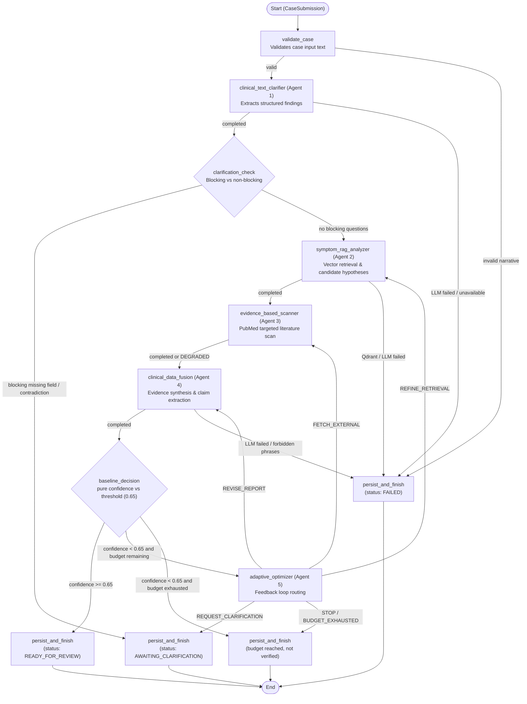

# Clinexus Architecture and Orchestration Topology

This document details the multi-agent system architecture for Clinexus, covering the deterministic baseline workflow implemented in Phase 3 and the safety-governed extensions scheduled for Phase 4.

---

## 1. Baseline Multi-Agent Graph (Phase 3)

The baseline pipeline models the paper-style sequential diagnosis generation pipeline using LangGraph (`BaselineWorkflowOrchestrator`), augmented with strict deterministic routing and failure semantics.

All routing transitions are pure deterministic Python functions—**never** determined by LLM prompts.

---

## 2. Phase 3 Components vs. Phase 4 Extensions

| Component / Subsystem | Phase 3 (Baseline) Implementation | Phase 4 (Approved Extensions) |
| :--- | :--- | :--- |
| **Agent 1: Clinical Text Clarifier** | Extracts structured demographics, clinical findings, polarity, source spans, and detects blocking contradictions/missing fields. | Remains core entry node; interacts with clarification request UI state. |
| **Agent 2: Symptom RAG Analyzer** | Dense vector search in Qdrant against BioASQ corpus; outputs candidate hypotheses and gap queries. Required node (outage halts workflow). | Adds contradiction-aware retrieval and benchmark mode integration. |
| **Agent 3: Evidence-Based Scanner** | External PubMed search via NCBI E-utilities. Deduplicates against local evidence. Non-fatal failure: outage yields `DEGRADED` status (`source_availability = 0.5`) and run continues with local evidence. | Integrates staleness flags and MeSH term expansion. |
| **Agent 4: Clinical Data Fusion** | 10-section report synthesis, claim citation validation (re-ask once on unretrieved IDs), forbidden language linter (`safety/forbidden_phrases.py`). | Retains 10-section generation, hands output to ClaimVerificationAgent. |
| **Agent 5: Adaptive Optimizer** | Operates exclusively on structural findings (retrieval volume, scanner degradation, unsupported claims, confidence score). Iteration cap: `MAX_OPTIMIZER_ITERATIONS = 3`. | Ingests verification outputs and explicit abstention triggers from safety gates. |
| **Claim Verification Agent (EXT-A)** | **Omitted in Baseline** (paper-style pipeline). | Dedicated Agent (`claim_verification_agent.py`) using NLI to verify every factual claim as `SUPPORTED`, `PARTIALLY_SUPPORTED`, `CONTRADICTED`, or `INSUFFICIENT`. |
| **Explicit Abstention (EXT-B)** | **Omitted in Baseline**. If budget exhausted without reaching confidence threshold, outputs final report labeled `"BASELINE: budget reached, not verified"`. | Safety gate (`safety/abstention.py`) halting with structured `AbstentionDecision` across 10 defined reason codes; suppresses speculative content. |
| **Provenance Graph (EXT-C)** | Relational execution persistence in PostgreSQL (`clinical_cases`, `case_findings`, `workflow_executions`, `agent_executions`, `retrieval_runs`, `report_versions`, `candidate_claims`, `optimization_iterations`). | Relational edge tables linking cases, queries, chunks, documents, claims, verifications, and audit events with typed relations. |
| **Human-in-the-Loop Review (EXT-D)** | Execution status marked `READY_FOR_REVIEW` or `AWAITING_CLARIFICATION`. | Full 8-state finite state machine (`orchestration/states.py`) with append-only clinical audit logging and action transitions. |

---

## 3. Failure & Degradation Semantics (SPEC Section 3)

1. **Deterministic State Transitions**:
   - Every node records an `AgentExecutionRecord` with status `RUNNING`, input hash, and timestamp prior to executing, followed by `COMPLETED`, `DEGRADED`, or `FAILED` with output hash upon finishing.
2. **Required Node Invariant**:
   - `clinical_text_clarifier`, `symptom_rag_analyzer`, and `clinical_data_fusion` are required nodes. If any required node encounters an unrecoverable error (e.g. Qdrant unreachable, LLM unavailable, or invalid JSON output), the workflow terminates immediately with `FAILED`. Downstream nodes are never executed.
3. **Graceful Scanner Degradation**:
   - `evidence_based_scanner` is optional. An outage or rate-limiting condition marks the scanner `DEGRADED`. Downstream fusion proceeds with local evidence only; `source_availability` reflects the degraded source in the confidence calculation ($1.0 \to 0.5$).
4. **Clarification Halting**:
   - If any `is_blocking=True` clarification question is identified (missing required age, sex, symptom duration, or semantic contradiction), the workflow halts immediately before retrieval with status `AWAITING_CLARIFICATION`.
5. **Startup Recovery**:
   - `reconcile_interrupted_executions()` scans PostgreSQL for executions left in status `RUNNING` (e.g. from container restart or power termination) and marks them `FAILED(failure_reason="INTERRUPTED")`.

---

## 4. Workflow Status to Review State Mapping (SPEC 5.4)

To prevent ambiguity when implementing the Phase 4 review state machine (`orchestration/states.py`), the table below defines the exact correspondence between the orchestrator execution statuses (`WorkflowState.workflow_status` / `ReportStatusEnum`) and the clinician review states defined in SPEC Section 5.4:

| Orchestrator Workflow Status (`ReportStatusEnum`) | SPEC 5.4 Review State | Mapping Rationale & Transition Trigger |
| :--- | :--- | :--- |
| `DRAFT` | `DRAFT` | Case submitted; report draft record initialized before orchestration begins. |
| `RUNNING` | `ANALYZING` | Graph execution active across agents (validation, clarifier, RAG, scanner, fusion, optimizer). |
| `AWAITING_CLARIFICATION` | `EVIDENCE_REVIEW_REQUIRED` | Halting before retrieval due to blocking patient clarification (missing duration, age, sex, or contradiction). Clinician must resolve or provide missing facts via `REQUEST_CLARIFICATION`. |
| `READY_FOR_REVIEW` | `READY_FOR_REVIEW` | Workflow successfully generated synthesis report. In the extended graph, reachable ONLY from `finalize_ready` after passing all safety gate rules; the baseline's path of completing without error is baseline-only. Awaiting clinician review actions. |
| `FAILED` | `FAILED` | Terminal execution failure (e.g., `LLM_UNAVAILABLE`, Qdrant unreachable, or forbidden treatment language). Allowed transition: to `ANALYZING` on retry. |
| *N/A (Phase 4 Extension B)* | `ABSTAINED` | Explicit abstention triggered by safety gate (`evaluate_gate`) on low confidence, unverified claims, or critical source outages. |
| *N/A (Phase 4 Extension D)* | `REVIEWED` | Clinician has completed review and marked report as `"Reviewed by clinician"`. |
| *N/A (Phase 4 Extension D)* | `REVISION_REQUESTED` | Clinician requested revision (`REQUEST_REVISION` or `REQUEST_EVIDENCE_REFRESH`), triggering re-entry to `ANALYZING`. |

